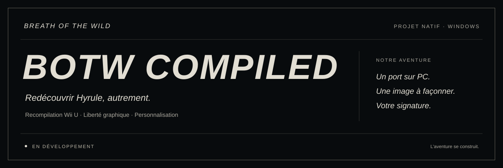
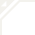
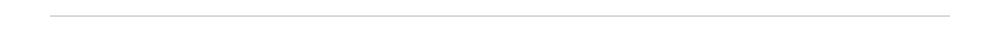

<p align="center">
  
</p>

<p align="center">
  <a href="#le-projet">Le projet</a> &nbsp;·&nbsp;
  <a href="#notre-vision">Notre vision</a> &nbsp;·&nbsp;
  <a href="#laventure-en-cours">Avancement</a> &nbsp;·&nbsp;
  <a href="#rejoindre-laventure">Commencer</a>
</p>

<h1 align="center"> Une nouvelle voie vers Hyrule.</h1>

<p align="center">
  Un port natif pour PC. Une image à façonner. Une aventure à personnaliser.
</p>

## Le projet

**BOTW Compiled** est notre projet de port natif de **The Legend of Zelda: Breath of the Wild**, à partir de sa version Wii U. Nous construisons une version Windows avec davantage de liberté pour le rendu et les créations personnalisées.

Notre ambition : retrouver l'identité visuelle d'Hyrule et ouvrir de nouvelles possibilités pour celles et ceux qui veulent aller plus loin.

> [!IMPORTANT]
> **L'aventure est encore en construction.** L'écran d'accueil et le début de l'introduction s'affichent. Le rendu 3D reste incomplet : le jeu n'est pas encore entièrement jouable.

## Notre vision

### Un port natif sur PC

Recompiler le code Wii U et construire les systèmes nécessaires à son exécution sur Windows. Le premier objectif reste un jeu stable, avec des personnages, des décors et des effets correctement affichés.

### Une image à votre mesure

Les dimensions de la fenêtre, la synchronisation verticale et le filtre de présentation sont déjà réglables séparément.

Nous voulons ensuite proposer deux axes indépendants : **résolution interne, ombres et distances d'affichage** d'un côté ; **éclairage, effets et textures** de l'autre. Ces améliorations restent à développer après la stabilisation du rendu d'origine.

### Votre signature dans Hyrule

Le logo d'accueil peut déjà être remplacé par un PNG personnalisé, avec conservation de l'original. Le remplacement local des shaders pixel est également disponible.

Le dossier [`custom-assets`](custom-assets/README.md) accueille vos textures, modèles, shaders et sons. L'intégration des autres types d'assets reste à construire.

<p align="center">
  
</p>

## L'aventure en cours

- [x] Base de recompilation Wii U et exécution native sur Windows.
- [x] Premiers écrans et début de l'introduction affichés.
- [x] Logo d'accueil personnalisé, installation réversible.
- [x] Réglages de présentation et remplacement de shaders pixel.
- [ ] Corriger le rendu 3D des personnages et des décors.
- [ ] Valider les déplacements, les combats et la progression.
- [ ] Développer les réglages graphiques avancés et l'intégration des assets.

Les observations et les limites actuelles sont détaillées dans le [suivi de validation](VALIDATION.md).

## Rejoindre l'aventure

Le dépôt contient les **sources, les outils de développement et les tests**. La préparation et la compilation sont décrites dans le [guide de démarrage](README-BOTW-Compiled.md).

```powershell
git clone https://github.com/P1kaCat/Breath-of-The-Wild-Compiled.git
cd Breath-of-The-Wild-Compiled
```

Les fichiers du jeu doivent être fournis séparément. Les données du jeu, les sauvegardes, les assets locaux et les résultats de compilation restent hors du dépôt.

Pour participer, [signalez un problème](https://github.com/P1kaCat/Breath-of-The-Wild-Compiled/issues) ou [proposez une contribution](https://github.com/P1kaCat/Breath-of-The-Wild-Compiled/pulls).

<p align="center">
  <br>
  <strong>BOTW COMPILED</strong><br>
  <sub>Redécouvrir Hyrule, autrement.</sub>
</p>

<p align="center">
  <sub><a href="README-BOTW-Compiled.md">Documentation</a> · <a href="custom-assets/README.md">Créations personnalisées</a> · <a href="SOURCE-PROVENANCE.md">Sources et licences</a></sub>
</p>
