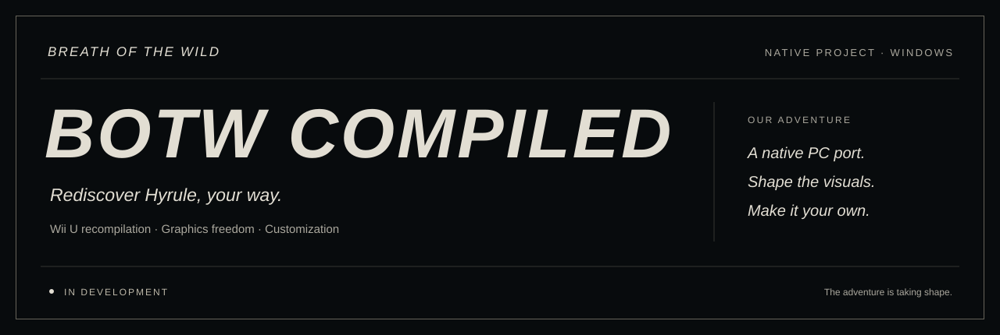

<p align="center">
  
</p>

<p align="center">
  <a href="#the-project">The project</a> &nbsp;·&nbsp;
  <a href="#our-vision">Our vision</a> &nbsp;·&nbsp;
  <a href="#the-adventure-so-far">Progress</a> &nbsp;·&nbsp;
  <a href="#join-the-adventure">Get started</a>
</p>

<h1 align="center"> A new path to Hyrule.</h1>

<p align="center">
  A native PC port. Visuals to shape. An adventure to make your own.
</p>

## The project

**BOTW Compiled** is our native port project for **The Legend of Zelda: Breath of the Wild**, starting from the Wii U version. We are building a Windows version with more freedom over graphics and custom creations.

Our ambition is to preserve Hyrule's visual identity while opening up new possibilities for those who want to go further.

> [!IMPORTANT]
> **This adventure is still under construction.** The opening screen and the beginning of the introduction render. 3D rendering remains incomplete: the game is not yet fully playable.

## Our vision

### A native PC port

Recompile the Wii U code and build the systems needed to run it on Windows. Our first goal is a stable game with correctly rendered characters, environments, and effects.

### Shape the visuals

Window dimensions, vertical synchronization, and the presentation filter already have separate settings.

We then want to develop two independent groups of options: **internal resolution, shadows, and draw distance** on one side; **lighting, effects, and textures** on the other. These improvements will follow work to stabilize the original rendering.

### Make Hyrule your own

The opening logo can already be replaced with a custom PNG while keeping the original backed up. Local pixel shader overrides are also available.

The [`custom-assets`](custom-assets/README.md) folder holds your textures, models, shaders, and audio. Support for integrating the other asset types is still to be built.

<p align="center">
  
</p>

## The adventure so far

- [x] Wii U recompilation foundation and native Windows execution.
- [x] Opening screen and beginning of the introduction rendered.
- [x] Custom opening logo with reversible installation.
- [x] Presentation settings and pixel shader overrides.
- [ ] Fix 3D rendering of characters and environments.
- [ ] Validate movement, combat, and game progression.
- [ ] Develop advanced graphics settings and custom asset integration.

See the [validation notes](VALIDATION.md) for observations and current limitations.

## Join the adventure

This repository contains **source code, development tools, and tests**. Preparation and build instructions are in the [getting started guide](README-BOTW-Compiled.md).

```powershell
git clone https://github.com/P1kaCat/Breath-of-The-Wild-Compiled.git
cd Breath-of-The-Wild-Compiled
```

You must provide the game files separately. Game data, saves, local custom assets, and build output stay outside this repository.

To take part, [report an issue](https://github.com/P1kaCat/Breath-of-The-Wild-Compiled/issues) or [submit a contribution](https://github.com/P1kaCat/Breath-of-The-Wild-Compiled/pulls).

<p align="center">
  <br>
  <strong>BOTW COMPILED</strong><br>
  <sub>Rediscover Hyrule, your way.</sub>
</p>

<p align="center">
  <sub><a href="README-BOTW-Compiled.md">Documentation</a> · <a href="custom-assets/README.md">Custom creations</a> · <a href="SOURCE-PROVENANCE.md">Sources and licenses</a></sub>
</p>
